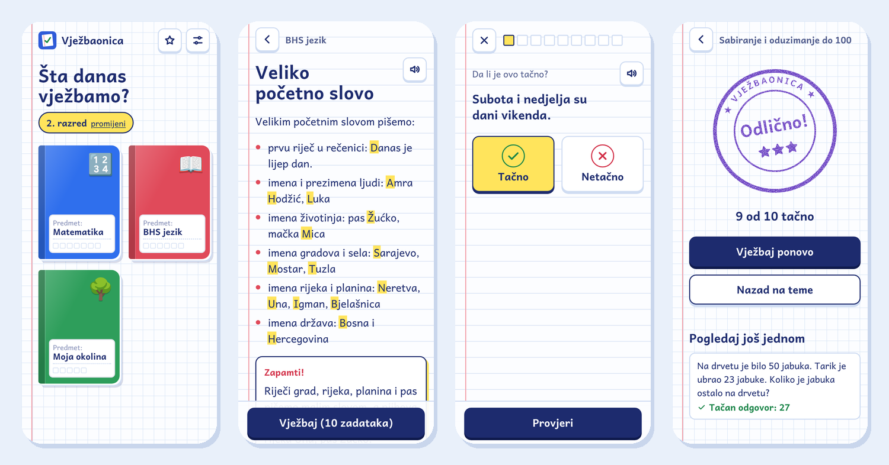

# Vježbaonica

Aplikacija za vježbanje i učenje gradiva u osnovnoj školi. Izgleda kao đačka sveska: dijete odabere predmet,
pročita kratku lekciju i riješi zadatke. Za svaku temu dobija zvjezdice, a na kraju vježbe i učiteljev pečat.



## Šta aplikacija radi

- **Lekcije i vježbe** po razredima, predmetima i temama. Za početak:
  2. razred (Matematika, Bosanski, hrvatski i srpski jezik i književnost, Moja okolina) te matematika za 1. i 3. razred.
- **Četiri vrste zadataka:** izbor ponuđenog odgovora, upis, tačno/netačno i slaganje pravilnim redom.
- **Matematički zadaci se generišu sami**, pa je svaka vježba drugačija. Uz svaki zadatak ide objašnjenje,
  npr. *„Saberi desetice pa jedinice: 30 + 20 = 50, 4 + 5 = 9, pa je 50 + 9 = 59.”*
- **Učenje na greškama:** netačno odgovorena pitanja ponavljaju se na kraju vježbe. Ako fale kvačice (kuca → kuća)
  ili je pogrešno veliko slovo, dijete dobija savjet.
- **Dugmad sa slovima č, ć, dž, đ, š, ž** za uređaje bez naše tastature.
- **Čitanje naglas** zadataka i lekcija, za djecu koja tek uče čitati.
- **Motivacija:** zvjezdice po temama, dani vježbanja zaredom i „đačka knjižica” s napretkom.
- Radi na **mobitelu, tabletu i računaru**. Može se instalirati kao aplikacija i radi **bez interneta**.
- **Bez registracije i bez slanja podataka.** Napredak se čuva samo na uređaju.
- **Gradivo se dodaje bez programiranja**, u jednostavnim JSON datotekama ([upute](docs/SADRZAJ.md)).

## Pokretanje na računaru

Potreban je [Node.js](https://nodejs.org) 22 ili noviji.

```bash
npm install
npm run dev
```

Zatim otvori adresu koju naredba ispiše (obično http://localhost:5173).

| Naredba              | Šta radi                                                                     |
| -------------------- | ---------------------------------------------------------------------------- |
| `npm run dev`        | pokreće aplikaciju za razvoj (promjene se odmah vide)                         |
| `npm test`           | pokreće sve testove                                                           |
| `npm run provjeri`   | provjerava samo sadržaj (JSON datoteke s gradivom)                            |
| `npm run lint`       | provjerava kod                                                                |
| `npm run build`      | pravi verziju za objavu u folderu `dist/`                                     |
| `npm run build:demo` | pravi cijelu aplikaciju kao jednu HTML datoteku (`dist-demo/index.html`)      |

## Dodavanje gradiva

Svaki predmet jednog razreda je jedna datoteka, npr. `src/content/2-razred/moja-okolina.json`.
Nova datoteka se automatski pojavi u aplikaciji. Sve vrste zadataka, lekcija i generatora opisane su u
**[docs/SADRZAJ.md](docs/SADRZAJ.md)**.

Poslije izmjene pokreni `npm run provjeri`. Provjera javlja tačno šta i gdje ne valja.

> Sadržaj za 2. razred napisan je prema gradivu 2. razreda u Kantonu Sarajevo.
> Prije šire upotrebe dobro je da ga pregleda učiteljica ili učitelj.

## Objavljivanje na internetu

Pri svakoj promjeni na grani `main` GitHub Actions pokreće provjeru koda, testove i build
(datoteka [`.github/workflows/ci.yml`](.github/workflows/ci.yml)).

- **Javni repozitorij:** aplikacija se sama objavljuje na GitHub Pages. To treba uključiti samo jednom:
  *Settings → Pages → Build and deployment → Source: GitHub Actions*. Adresa će biti
  `https://<korisnik>.github.io/vjezbaonica/`.
- **Privatni repozitorij:** za GitHub Pages iz privatnog repozitorija treba plaćeni GitHub plan.
  Besplatno rješenje je npr. [Netlify](https://www.netlify.com) ili [Cloudflare Pages](https://pages.cloudflare.com):
  build naredba `npm run build`, folder za objavu `dist`.

Aplikacija koristi relativne putanje, pa radi na bilo kojoj adresi bez dodatnog podešavanja.

## Instalacija na mobitel

Otvori adresu aplikacije u pregledaču, pa:

- **Android (Chrome):** meni ⋮ → *Dodaj na početni ekran* ili *Instaliraj aplikaciju*
- **iPhone i iPad (Safari):** dugme *Dijeli* → *Dodaj na početni ekran*

Nakon prvog otvaranja aplikacija radi i bez interneta.

## Struktura projekta

```
src/
├── content/      gradivo (JSON) i njegovo učitavanje
├── lib/          logika: zadaci, generatori, ocjenjivanje, napredak, postavke, čitanje naglas
├── components/   dijelovi ekrana: korice sveske, zadaci, pečat, zvjezdice…
├── pages/        ekrani: početna, predmet, lekcija, vježba, napredak, postavke
└── styles/       izgled (global.css, boje i slova na vrhu datoteke)
docs/             upute za sadržaj i slike
public/           ikone aplikacije
```

Tehnologija: React, TypeScript i Vite. Aplikacija nema server ni bazu podataka.

## Ideje za dalje

- ostali predmeti i razredi
- novi tip zadatka: spajanje parova
- više profila na jednom uređaju (za braću i sestre)
- pregled napretka za roditelje i učitelje
- ćirilica (font je već pripremljen)
- zadaci sa slikama i zvukom

## Licenca

Repozitorij za sada nema licencu, pa sva prava zadržava autor. Ako ga želiš otvoriti drugima,
dodaj datoteku `LICENSE` (npr. MIT za kod, a za sadržaj Creative Commons).

Font [Andika](https://software.sil.org/andika/) je pod licencom SIL Open Font License.
